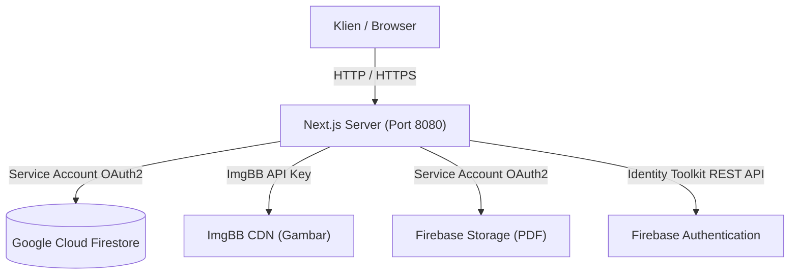

# PPDB SMK Bani Masum

Sistem informasi Penerimaan Peserta Didik Baru (PPDB) dan portal layanan digital untuk SMK Bani Masum. Aplikasi ini menangani seluruh alur pendaftaran siswa baru secara online, pencetakan kartu tanda peserta resmi, sistem pesanan digital E-Kantin sekolah, hingga panel admin untuk verifikasi berkas dan pengelolaan konten website.

---

## Teknologi

- **Framework**: Next.js 16 (App Router, mode standalone untuk Docker)
- **Bahasa**: TypeScript di seluruh codebase
- **Styling**: Tailwind CSS 4 dengan dukungan tema terang dan gelap
- **Animasi**: Framer Motion dan transisi CSS native
- **Database Utama**: Google Cloud Firestore (data pendaftar, pesanan kantin, jadwal gelombang, galeri dokumentasi)
- **Penyimpanan Berkas Gambar**: ImgBB API (CDN global untuk foto berkas pendaftar dan dokumentasi kegiatan)
- **Penyimpanan Berkas PDF**: Firebase Cloud Storage (dokumen pendaftaran format PDF dengan signed URL)
- **Autentikasi Admin**: Firebase Authentication dengan verifikasi server-side dan sesi cookie httpOnly HMAC-SHA256

---

## Struktur Direktori

```
BaniMaHub-PPDB/
├── app/
│   ├── admin/                  # Dashboard admin utama, login, dan manajemen pendaftar
│   │   ├── dashboard/          # Ringkasan analitik dan kuota
│   │   ├── ekantin/            # POS dan manajemen pesanan E-Kantin admin
│   │   ├── login/              # Form autentikasi panitia
│   │   └── pendaftar/          # Tabel detail data pendaftar
│   ├── api/
│   │   ├── admin/
│   │   │   ├── login/          # POST login sesi, DELETE logout
│   │   │   └── pendaftar/      # REST endpoint data pendaftar (admin only)
│   │   ├── ekantin/
│   │   │   ├── orders/         # CRUD pesanan kantin digital
│   │   │   └── products/       # Katalog menu kantin
│   │   ├── pendaftaran/        # GET cek status registrasi, POST formulir pendaftar baru
│   │   ├── schedule/           # GET dan POST jadwal gelombang seleksi (Firestore)
│   │   └── showcase/           # GET dan POST galeri prestasi serta kegiatan sekolah
│   │       └── upload/         # POST upload gambar ke ImgBB
│   ├── components/             # Komponen UI bersama (header, theme toggle, motion)
│   ├── ekantin/                # Katalog menu dan keranjang belanja siswa
│   ├── faq/                    # Halaman tanya jawab seputar PPDB
│   ├── jurusan/                # Profil kompetensi keahlian (RPL dan TBSM)
│   ├── lib/
│   │   ├── admin-auth.ts       # Verifikasi sesi HMAC-SHA256 dan hak akses admin
│   │   ├── firebase-server.ts  # Klien REST Firestore, Storage, dan ImgBB via Service Account
│   │   ├── private-config.ts   # Kredensial server tertanam
│   │   └── ppdb-data.ts        # Data default jadwal, jurusan, prestasi, dan kegiatan
│   ├── ppdb/
│   │   ├── cek-status/         # Pencarian status verifikasi mandiri oleh siswa
│   │   ├── daftar/             # Formulir pendaftaran online multi-tahap
│   │   ├── kartu/              # Tampilan kartu peserta
│   │   ├── pembayaran/         # Informasi biaya dan panduan pembayaran
│   │   ├── pengumuman/         # Pengumuman kelulusan hasil seleksi
│   │   ├── ranking/            # Peringkat nilai pendaftar
│   │   └── tiket/              # Cetak resmi Kartu Tanda Peserta PPDB (standar kertas putih)
│   ├── tentang/                # Profil sekolah, visi-misi, dan lokasi
│   ├── layout.tsx              # Root layout aplikasi
│   └── page.tsx                # Halaman beranda publik
├── firestore.rules             # Aturan keamanan Cloud Firestore
├── storage.rules               # Aturan keamanan Firebase Cloud Storage
├── next.config.ts              # Konfigurasi Next.js dan remote image patterns
├── Dockerfile                  # Multi-stage Docker build
└── docker-compose.yml          # Konfigurasi deployment container
```

---

## Modul dan Fitur Utama

### 1. Alur Pendaftaran Siswa (PPDB Online)
- Formulir pendaftaran multi-langkah dengan validasi NISN, tanggal lahir, data orang tua, dan pilihan program keahlian.
- Upload berkas persyaratan: Kartu Keluarga (KK), Ijazah/SKL, dan Pas Foto 3x4 (mendukung format gambar via ImgBB dan dokumen PDF via Firebase Storage).
- Pembuatan nomor registrasi unik otomatis dengan format `BM26-[HEX16]`.
- Pencarian status berkas mandiri (`/ppdb/cek-status`) tanpa mengekspos data pribadi siswa lain.

### 2. Cetak Kartu Tanda Peserta Resmi (`/ppdb/tiket`)
- Dokumen credential resmi sekolah dengan Kop Surat SMK Bani Masum lengkap dengan alamat, NPSN, dan kontak.
- Pas Foto siswa ukuran 3x4 dengan frame resmi.
- Validasi QR Code untuk verifikasi keaslian berkas registrasi.
- Tampilan strict white paper layout (`#ffffff`) baik di layar maupun saat dicetak (`@media print` standar A4/F4), bebas dari elemen dark mode saat masuk mode cetak.

### 3. Executive Admin Command Center (`/admin`)
- Header adaptif dark mode / light mode dengan kontrol tema terintegrasi.
- Quick Actions: Kelola Jadwal Gelombang, Prestasi & Kegiatan, Analisis Minat, Rekapitulasi Cetak PDF, dan Siaran WhatsApp.
- Kartu Target Kuota Penerimaan interaktif dengan animasi transisi halus (CSS Grid accordion) saat di-minimize atau di-expand.
- Filter jurusan RPL dan TBSM dengan rasio kontras tinggi standar WCAG AA di dark mode.
- Tabel dan kartu pendaftar dengan filter kelengkapan berkas, ubah status cepat, catatan panitia, batch action, dan export data ke format CSV.

### 4. Manajemen Dinamis Prestasi & Kegiatan Sekolah
- Admin dapat menambah, mengubah, menggeser urutan, dan menghapus dokumentasi Prestasi Siswa dan Kegiatan Sekolah & Praktik.
- Foto fisik otomatis diunggah ke ImgBB Cloud Storage dengan CDN berkecepatan tinggi.
- Metadata lengkap (judul, deskripsi, urutan, dan URL foto) disimpan langsung di Cloud Firestore pada path dokumen `settings/showcase`.
- Data tersinkronisasi otomatis ke halaman beranda (`app/page.tsx`).

### 5. Jadwal Gelombang Seleksi Dinamis
- Pengaturan tahapan seleksi (pendaftaran, verifikasi, pengumuman, daftar ulang) dapat diubah langsung oleh panitia dari panel admin tanpa menyentuh kode program.
- Data tersimpan di Cloud Firestore pada path dokumen `settings/schedule`.

### 6. Sistem E-Kantin Sekolah (`/ekantin` & `/admin/ekantin`)
- Katalog produk makanan dan minuman kantin sekolah dengan sistem keranjang belanja interaktif.
- Struk nota pesanan digital dengan rincian item, nomor pesanan, dan total bayar.
- Panel POS Admin E-Kantin dengan filter status pesanan (Semua, Menunggu, Diproses, Selesai, Dibatalkan), kartu KPI pendapatan harian, dan tombol chat WhatsApp instan ke nomor pemesan.

---

## Arsitektur Data dan Integrasi



### Penyimpanan Dokumen dan Gambar

| Jenis Data | Tempat Penyimpanan | Keterangan |
| :--- | :--- | :--- |
| Data Pendaftar | Firestore (`registrations/{id}`) | Lengkap, diakses server dengan Service Account |
| Status Publik | Firestore (`registration_status/{id}`) | Hanya memuat nomor, nama, dan status verifikasi |
| Jadwal Seleksi | Firestore (`settings/schedule`) | Array tahapan gelombang seleksi |
| Galeri Prestasi & Kegiatan | Firestore (`settings/showcase`) | Array metadata prestasi dan kegiatan sekolah |
| Foto Berkas & Dokumentasi | ImgBB Cloud Storage | URL permanen format CDN (`https://i.ibb.co.com/...`) |
| Dokumen PDF Berkas | Firebase Cloud Storage | Path `BM26-.../` dengan link signed URL sementara |
| Pesanan E-Kantin | Firestore (`orders/{orderId}`) | Transaksi pemesanan dan status kantin |

---

## Panduan Menjalankan Project

### Persyaratan Lingkungan
- Node.js versi 20 atau 22 LTS
- Package manager npm versi 10 ke atas

### Instalasi Dependensi

```bash
# Clone repository
git clone https://github.com/0xHadiRamdhani/BaniMaHub-PPDB.git
cd BaniMaHub-PPDB

# Install paket dependensi
npm install
```

### Menjalankan Server Development

```bash
npm run dev
```

Aplikasi berjalan pada alamat `http://localhost:8080`.

### Membangun Versi Produksi

```bash
npm run build
npm run start
```

---

## Deployment

### 1. Deployment via Docker

Aplikasi telah dikonfigurasi untuk mode `standalone` dengan multi-stage Docker build:

```bash
# Build image dan jalankan container di background
docker compose up --build -d

# Periksa status container
docker compose ps

# Memantau log aplikasi
docker compose logs -f

# Menghentikan container
docker compose down
```

Container berjalan secara aman menggunakan user non-root `nextjs:nodejs` pada port internal 8080.

### 2. Reverse Proxy Nginx (Server VPS)

Gunakan Nginx untuk menangani sertifikat SSL/TLS dan meneruskan traffic ke container port 8080:

```nginx
server {
    listen 443 ssl http2;
    server_name ppdb.smkbanimasum.sch.id;

    ssl_certificate     /etc/letsencrypt/live/ppdb.smkbanimasum.sch.id/fullchain.pem;
    ssl_certificate_key /etc/letsencrypt/live/ppdb.smkbanimasum.sch.id/privkey.pem;

    location / {
        proxy_pass         http://127.0.0.1:8080;
        proxy_http_version 1.1;
        proxy_set_header   Upgrade           $http_upgrade;
        proxy_set_header   Connection        "upgrade";
        proxy_set_header   Host              $host;
        proxy_set_header   X-Real-IP         $remote_addr;
        proxy_set_header   X-Forwarded-For   $proxy_add_x_forwarded_for;
        proxy_set_header   X-Forwarded-Proto $scheme;
    }
}
```

### 3. Deployment ke Vercel

Aplikasi siap di-deploy langsung ke Vercel. Kredensial server tersimpan aman di modul server. Untuk menjaga masa aktif sesi admin tetap konsisten saat server restart, atur environment variable `ADMIN_SESSION_SECRET` pada pengaturan project Vercel:

```bash
node -e "console.log(require('crypto').randomBytes(32).toString('hex'))"
```

---

## Keamanan Sistem

- **Sesi Admin Terproteksi**: Token sesi ditandatangani menggunakan algoritma HMAC-SHA256 dan disimpan dalam cookie berflag `httpOnly`, `secure`, dan `sameSite=strict` sehingga tidak dapat diakses melalui JavaScript browser.
- **Rate Limiting Login**: Endpoint autentikasi admin menerapkan pembatasan maksimal 5 kali percobaan login per alamat IP dalam rentang 15 menit untuk mencegah serangan brute-force.
- **Pemisahan Hak Akses Firestore**: Berkas `firestore.rules` membatasi hak akses publik hanya pada pembuatan formulir baru dan pembacaan ringkasan status registrasi. Data pribadi lengkap pendaftar (NISN, nomor HP orang tua, berkas dokumen) hanya dapat dibaca melalui Service Account sisi server.
- **Isolasi Berkas PDF**: Dokumen PDF di Firebase Storage tidak memiliki izin baca publik langsung dari browser, melainkan hanya dapat diakses melalui signed URL bertempo terbatas (5 menit) yang dibuat khusus untuk sesi panitia yang sah.

---

## Program Keahlian

- **Rekayasa Perangkat Lunak (RPL)**: Fokus pada pemrograman web, aplikasi mobile, basis data, dan rekayasa perangkat lunak berstandar industri digital.
- **Teknik dan Bisnis Sepeda Motor (TBSM)**: Fokus pada pemeliharaan mesin sepeda motor, sistem kelistrikan, tata kelola bengkel resmi, dan diagnosis kendaraan modern.
